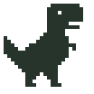
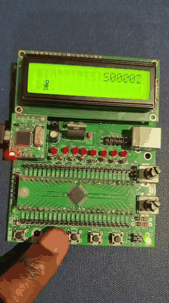
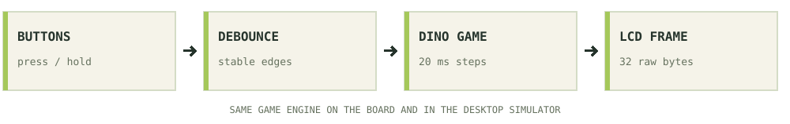

<a name="top"></a>

<p align="center" data-runner-start>
    <picture>
      <source media="(prefers-reduced-motion: reduce) and (prefers-color-scheme: dark)" srcset="assets/readme/dino-dark.png">
      <source media="(prefers-reduced-motion: reduce)" srcset="assets/readme/dino-light.png">
      <source media="(prefers-color-scheme: dark)" srcset="assets/readme/dino-dark.gif">
      
    </picture>
</p>

<h1 align="center">ChromeDinoSTM32</h1>

<p align="center">
  <b>A tiny screen with a familiar dinosaur.</b><br>
  Chrome's offline Dino game, adapted in C for my UCT STM32F051C6Tx development board.
</p>

<p align="center" data-tech-stack>
  <picture>
    <source media="(prefers-color-scheme: dark)" srcset="assets/readme/stack/c-dark.svg">
    
  </picture>
  <picture>
    <source media="(prefers-color-scheme: dark)" srcset="assets/readme/stack/stm32-hal-dark.svg">
    
  </picture>
  <picture>
    <source media="(prefers-color-scheme: dark)" srcset="assets/readme/stack/cmsis-dark.svg">
    
  </picture>
  <picture>
    <source media="(prefers-color-scheme: dark)" srcset="assets/readme/stack/arm-gcc-dark.svg">
    
  </picture>
  <picture>
    <source media="(prefers-color-scheme: dark)" srcset="assets/readme/stack/cubeide-dark.svg">
    
  </picture>
  <picture>
    <source media="(prefers-color-scheme: dark)" srcset="assets/readme/stack/python-dark.svg">
    
  </picture>
  <picture>
    <source media="(prefers-color-scheme: dark)" srcset="assets/readme/stack/make-dark.svg">
    
  </picture>
</p>

<p align="center">
  <a href="#the-build">Watch it run</a> ·
  <a href="#build-and-run">Build it</a> ·
  <a href="#how-the-code-works">Inside the code</a> ·
  <a href="#top">The little Dino</a>
</p>

## Background

I've always wanted to code the Chrome Dino game. I thought though that coding it on a panel with java would be too straightforward. It then hit me that I have the UCT Dev Board, where i can make it an Embedded Systems project that would be much more of exciting challenge to take.

It has enough for a classic arcade game: buttons and an LCD. So the idea fit well. 

The Dev board has **16 columns and two rows of characters**. So the Dino, the cacti, the birds and the score all have to fit inside that. Which I did not expect be such a pain to get right.

My objective was to make a small, playable embedded game and keep the code understandable. The final build has animated running, jumping, ducking, faster descent, obstacles, increasing speed, pause, retry and a session best score. It runs on the board's own LCD and buttons.

## The Build

<table>
<tr>
<td width="43%" align="center" valign="top">
<a href="demonstration/final_build.mp4"></a>
</td>
<td width="57%" valign="top">
<h3>Yes, it fits on that screen.</h3>
<p>This is the game running on my development board. You can see the Dino jump, the obstacles move across the bottom row and the score increase.</p>
<p>The preview is a short loop from the recording. The full video is about 35 seconds.</p>
<p><b><a href="demonstration/final_build.mp4">▶ Watch the full board demonstration</a></b></p>
<p>If GitHub opens the file without playing it, use <b>Download raw file</b> and open it on your computer.</p>
<p><i>The original recording is in <code>demonstration/final_build.mp4</code>. The preview is only a smaller copy for the README.</i></p>
</td>
</tr>
</table>

## Project Overview

| Part | What I am using |
|---|---|
| Board | UCT development board with **STM32F051C6Tx**, LQFP48 |
| Processor | Arm Cortex-M0, running at 48 MHz from an 8 MHz crystal and PLL |
| Screen | Onboard WC1602A, 16 × 2 character LCD |
| Controls | Four active-low buttons, SW0 to SW3 |
| Firmware | C11, CMSIS and STM32F0 HAL support |
| Memory available | 32 KiB flash and 8 KiB RAM |
| Game timing | One fixed update every 20 ms |
| Extra hardware | None needed for the game; ST-LINK/SWD is used to program it |

<details>
<summary><b>A few terms before we carry on</b></summary>

- **Firmware:** the program that runs on the board.
- **Flashing:** copying that program into the board's flash memory. Building it on your computer does not flash it.
- **Debouncing:** waiting for a button signal to settle so one press becomes one action.
- **CGRAM:** the LCD's small memory for custom character shapes. This is where the Dino and obstacles live.
- **Fixed time step:** updating the game at a consistent interval so its timing does not depend on how much the screen needs to redraw.

</details>

## Contents

1. [Playing the game](#playing-the-game)
2. [Making a dinosaur fit](#making-the-dinosaur-fit)
3. [How the code works](#how-the-code-works)
4. [Build and run](#build-and-run)
5. [Test it without a board](#test-it)
6. [Checks and limits](#checks-and-limits)
7. [Repo structure](#repo-structure)
8. [The little Dino](#top)
9. [Credits](#credits)

<p align="center"><picture><source media="(prefers-color-scheme: dark)" srcset="assets/readme/divider-dark.svg"></picture></p>

## Playing The Game

Well I don't expect anyone reading this to have an actual UCT Dev Board laying around, but perhaps its worth explaining the controls for anyone curious to see how it aligns with the demonstration video above and the code. [An LCD+Breadboard built could work just the same with any other processor to be honest].

Press **SW0** to start. From there, keep the Dino clear of whatever is coming across the screen.

| Button | What it does |
|---|---|
| **SW0** | Start, jump, or retry after a collision |
| **SW1** | Hold to duck under birds; hold in the air to come down faster |
| **SW2** | Pause or resume the whole run |
| **SW3** | Return to the title screen |

Cacti need a jump. Birds can be jumped or ducked. Holding SW0 does not make the Dino jump repeatedly, so each jump needs a new press. A press just before landing is buffered for the next jump.

The score counts the columns you have travelled. The game starts at 180 ms per column, gets faster every 50 points and stops getting faster at 90 ms per column. Birds join the obstacle selection from 50 points. The best score stays in RAM until you reset the board or remove power.

The green status LED is on when the game is ready or running. A collision lights the red LED and shows the retry prompt.

More timing details are in [Playing Dino](docs/gameplay.md).

## Making the Dinosaur fit

This LCD does not take a framebuffer of browser graphics. Each position holds one character, and the controller gives me **eight custom 5 × 8 pixel characters** to work with.

Those eight slots hold two running poses, a jump, a duck, a cactus, two bird poses and a crash pose. During play, the Dino runs on the bottom row and jumps to the top row. The score sits at the top right. Obstacles move through the bottom row, one character column at a time.

That small display changes the way the game feels. A jump lasts 680 ms, and obstacle spacing is measured in columns. Even at the fastest speed, the minimum gap leaves time for a complete jump and landing. Compile-time checks reject settings that would make those gaps too short.

The LCD also has a small trap: custom character **zero** is a real sprite. A C string treats zero as the end. So the renderer passes two arrays of 16 raw bytes to the display driver, rather than passing strings and hoping for the best.

## How the code works

I split the game, the buttons and the board driver by what each one needs to know. The game can advance and check collisions without knowing a GPIO pin exists. That is what lets the same engine run in the desktop simulator and the automated tests.

<p align="center">
  <picture>
    <source media="(prefers-color-scheme: dark)" srcset="assets/readme/architecture-dark.svg">
    
  </picture>
</p>

| Piece | Its job |
|---|---|
| `DinoGame` | Owns the player, obstacle pool, score, random state and game timers |
| `DinoButtons` | Owns the four debounce timers and reports new presses and held buttons |
| `dino_game_render()` | Converts the game into the two LCD rows |
| `board_io` | Reads the physical buttons, loads custom characters and writes changed screen regions |
| `main` | Collects input, advances the game at the fixed interval and updates the display |

This is C, so these objects are structs with functions that operate on them. There is no C++ runtime or dynamic allocation. The obstacle pool has a fixed size, the timing uses integers and the board keeps the EEPROM deselected.

The game checks collisions every 20 ms, including between screen movements. Landing on a cactus must still count as a collision. Pause freezes the jump, the obstacles and the animation together.

The display driver remembers the last frame and only sends the parts that changed. Clearing the whole LCD every frame would add delay and visible flicker. A small cache is enough to avoid that.

For the full layout and tuning settings, see [Design and tuning](docs/architecture.md). The constants you will probably want first are in [`Core/Inc/dino_config.h`](Core/Inc/dino_config.h).

<p align="center"><picture><source media="(prefers-color-scheme: dark)" srcset="assets/readme/divider-dark.svg"></picture></p>

## Build and Run

If somehow one would want to recreate this:

### You would need

- The STM32F051C6Tx board (Or any processor board tbh) and a working ST-LINK/SWD connection (UART pins can also be used to flash the code if an STM32 processor is owned with no ST-LINK).
- STM32CubeIDE (This IDE helped me quite a lot here. It is very involved and easy to use. I heard we would use it for my second embedded systmes course so i tried to familiarize myself with it), or **Python 3.9+ and GNU Arm GCC 11+** for the command-line build.
- A host GCC compiler if you want to run the tests or desktop simulator.

### STM32CubeIDE Instructions

1. Choose **File → Import → General → Existing Projects into Workspace** and select this repository folder.
2. Set **Project → Build Configurations → Set Active → Debug**.
3. Build the project.
4. Open **Run → Debug Configurations → STM32 C/C++ Application → ChromeDinoSTM32 Debug**.
5. With the board connected, click **Debug**. It downloads the firmware and normally stops at `main`. Choose **Resume / F8** to let the game run.

You should see **Debug and Release** configurations. If the menu only lists **Default**, the workspace has a generic C/C++ project loaded. Follow the [CubeIDE recovery steps](docs/cubeide.md#reload-settings-in-the-running-workspace) before trying to launch again.

Both Debug and Release can be programmed. The supplied launch files select their matching build and ELF, so you can use **ChromeDinoSTM32 Release** for that configuration.

> **Build and flash are different steps.** Build creates the firmware on your computer. The ST-LINK launch or the explicit flash command writes it to the board.

CubeIDE puts its firmware in `Debug/ChromeDinoSTM32.elf` or `Release/ChromeDinoSTM32.elf`.

### Command line

From the repository directory, on Windows:

```powershell
.\build.ps1
.\build.ps1 -Configuration Debug
.\build.ps1 -Action test
.\build.ps1 -Action sim
```

The Python entry point works directly too:

```sh
python tools/build.py build --config Release
python tools/build.py build --config Debug
python tools/build.py test
python tools/build.py sim
```

Or use `make`, `make CONFIG=Debug`, `make test` and `make sim`.

The command-line build creates ELF, HEX, BIN and map files in `build/Release/` or `build/Debug/`. It also checks the C6 memory layout and reset vectors. These output directories are separate from CubeIDE's `Debug/` and `Release/` directories.

The Windows build detects CubeIDE's compiler. To select another toolchain:

```powershell
.\build.ps1 -GccPath 'C:\path\to\arm-toolchain\bin'
```

Or use `python tools/build.py build --gcc-path /path/to/bin`. A successful compiler selection is remembered in the ignored `.toolchain.local.json` file.

To **build, program, verify and reset** a connected board with STM32CubeProgrammer:

```sh
python tools/build.py flash --config Release
```

That command replaces the firmware already on the board. A plain build never flashes it.

### A few board details that matter

The target is **STM32F051C6Tx: 32 KiB flash, 8 KiB RAM**. ST's shared header uses the `STM32F051x8` preprocessor symbol for this family. The linker script still enforces the C6 memory limits.

The LCD's D4–D7 lines use **PB8, PB9, PA12 and PA15**. The default RS/E assignment is **PC14/PC15**. If your board's control lines are reversed, hold **SW3 during reset**, then release it. Adjust **POT2** if the screen is blank or shows blocks.

PA13/PA14 remain available for SWD. The `.ioc` is a device and clock reference; regenerating sources from it can overwrite the game's custom board code. More wiring and troubleshooting details are in [Board setup](docs/board.md).

## Test it

Build the simulator with `python tools/build.py sim`, then run the executable it prints:

```powershell
.\build\simulator\dino_simulator.exe
```

On Linux, run `./build/simulator/dino_simulator` instead.

| Key | Action |
|---|---|
| **Space** | Start, jump or retry |
| **D** | Toggle duck |
| **P** | Pause or resume |
| **R** | Return to the title |
| **Q** | Quit |

The simulator shares the real game engine. It uses letters for the sprites, and duck is a toggle because terminal input does not reliably report key releases. On the board, SW1 is held. The physical demonstration is the video above.

## Checks and limits

The host tests exercise button bounce, simultaneous presses, tick rollover, pause, restart, jump buffering, fast descent, collision boundaries, LCD frames, sprite pixels and independent game objects. They also run **32 seeded obstacle courses for 40,000 ticks each: 1.28 million game steps**.

The linked firmware is checked against the C6's actual memory sizes. The standalone builds recorded these sizes:

| Configuration | Flash image | RAM including linker reservations |
|---|---:|---:|
| Release | 4,860 / 32,768 bytes | 2,672 / 8,192 bytes |
| Debug | 7,800 / 32,768 bytes | 2,672 / 8,192 bytes |

The RAM figure includes the reserved stack and heap; it is not a measured peak stack trace. Full build checks are in [Build and verification](docs/testing.md).

There are some deliberate limits. Movement is one LCD character column at a time. The best score is lost on reset. The onboard EEPROM is not used for saving runs. The host tests check logic; the board demonstration shows the physical result.

## Repo structure

```text
Core/                 C game, button logic, LCD driver and STM32 startup
Drivers/              CMSIS and STM32F0 HAL support, with component licences
STM32F051C6TX_FLASH.ld C6 memory layout
assets/readme/        Pixel artwork, running Dino and demonstration preview
demonstration/        The original board demonstration video
docs/                 Setup, gameplay, design and verification notes
  interactive/        The scroll-following version of this README
tests/                Portable game tests and CubeIDE project checks
tools/                Build, firmware verification, simulator and README preview
Makefile              Build, test, simulator and flash entry points
build.ps1             Windows build entry point
```


## Credits

Chrome's offline Dino game is the inspiration. The board support follows the UCT EEE3096S practical setup supplied with this board. ST's CMSIS, HAL and startup notices are kept with their component licences; see [THIRD_PARTY.md](THIRD_PARTY.md).

The pixel artwork in this README is drawn for this project. The demonstration is my real board running the game.

<p align="center"><picture><source media="(prefers-reduced-motion: reduce) and (prefers-color-scheme: dark)" srcset="assets/readme/dino-dark.png">
      <source media="(prefers-reduced-motion: reduce)" srcset="assets/readme/dino-light.png">
      <source media="(prefers-color-scheme: dark)" srcset="assets/readme/dino-dark.gif"></picture><br><sub>THANK YOU FOR READING! <a href="#top">You can run along back to the top now.</a></sub></p>
